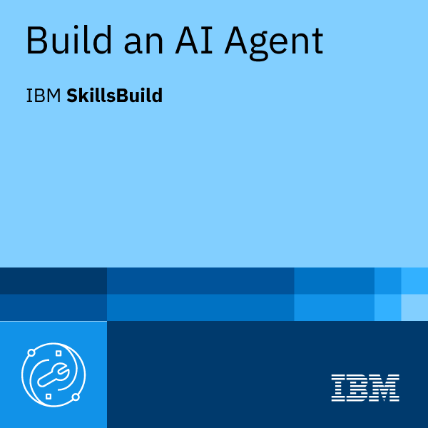
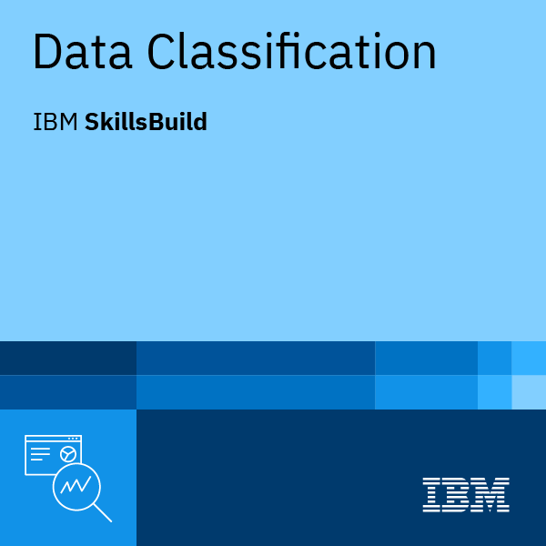
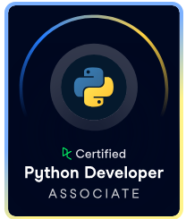

  

  

---

## About

I'm a computer science student who enjoys turning real problems into deployed software. I work mostly on backend systems and full-stack products, and I'm going deeper into **machine learning, deep learning and AI agents**.

During my internship at **Groupe Seghaier** I was assigned the backend of a B2B platform, and I also designed and built the entire frontend. I designed and developed **Afya**, a digital health platform for Tunisia, end to end. I like clean API design, secure authentication, and projects that are live rather than just demoed.

---

## Selected projects

### Afya: digital health platform for Tunisia

An integration project in the Clinique Les Oliviers context, designed and developed end to end by me. Afya provides health information and guidance, not a medical diagnosis.

- Symptom checker with an interactive body map and weighted-score triage (emergency, rapid, normal consultation, self-care)
- Tunisian medication guide with CNAM reimbursement information
- Health facility directory with geolocation, medical encyclopedia, articles, and health calculators
- Admin analytics dashboard

**Next: AI upgrade (planned)**

- A machine learning model for triage urgency, benchmarked against the current weighted-score rules
- Deep learning and neural network components for understanding symptom descriptions
- Explainable results, so every recommendation shows why it was made

<b>Stack and design</b>

 

- **Current version:** React, Node.js/Express REST API, MongoDB
- **Rewrite in progress:** Next.js (App Router), TypeScript, Tailwind CSS, shadcn/ui, multilingual support with next-intl
- **Design work:** UML use case, class, and sequence diagrams (authentication flow, symptom-checker flow)

[Repository](https://github.com/yomnaa06/Afya) · [Live demo](https://vercel.com/yomnaa06s-projects/afya)

 

### Seghaier: B2B platform for an auto-parts distributor

Internship project: digitalizing the B2B relationship for a car-parts distributor.

- JWT authentication with role-based access (Client and Admin)
- Quote requests (Devis) and complaints (Réclamations) workflows with email notifications
- Admin dashboard
- Assigned the backend, and also designed and built the complete frontend

<b>Stack and deployment</b>

 

- **Backend:** TypeScript, Node.js, Express, Prisma ORM, MySQL, Nodemailer, bcrypt, Docker
- **Deployment:** frontend on Vercel, API on Render, MySQL on Aiven
- **Design work:** UML use case, sequence, and class diagrams (Draw.io), API testing with Postman

[Repository](https://github.com/yomnaa06/final_seghaier) · [Live demo](https://vercel.com/yomnaa06s-projects/seghaier_frontend)

---

## Skills

### Languages

  

SQL · JSON · YAML · Dockerfile · Markdown

### Backend and web

  

REST API design · JWT authentication · role-based access control · input validation · email workflows (Nodemailer) · password hashing (bcrypt) · multilingual apps (next-intl)

### Databases

  

SQL · PostgreSQL · MySQL · relational modeling · Prisma schemas and seeding · NoSQL document design (MongoDB)

### Data, machine learning and deep learning

Data analysis and cleaning · data classification · supervised and reinforcement learning · neural networks and convolutional networks · natural language processing · building AI agents

### Tools and DevOps

  

Git and GitHub workflows · containerization with Docker · deployment on Vercel, Render and Aiven · UML modeling with Draw.io · API testing with Postman

### Certifications

<table>
  <tr>
    <td valign="middle" width="55%">
      <b>Harvard CS50: Introduction to Artificial Intelligence with Python</b> 
      Search, knowledge, uncertainty, optimization, machine learning, neural networks and language
    </td>
    <td valign="middle" align="center" width="45%">
      
    </td>
  </tr>
  <tr>
    <td valign="middle" width="55%">
      <b>IBM SkillsBuild</b> 
      Build an AI Agent: designing and building AI agents 
      Data Classification: classifying data with machine learning
    </td>
    <td valign="middle" align="center" width="45%">
      
      &nbsp;
      
    </td>
  </tr>
  <tr>
    <td valign="middle" width="55%">
      <b>DataCamp</b> 
      <a href="https://www.datacamp.com/certificate/PDEVA0012418323000">Python Developer Associate</a>: Python programming and well-structured code 
      <a href="https://www.datacamp.com/certificate/DAA0019674669439">Data Analyst Associate</a>: SQL, data cleaning, analysis and visualization 
      <a href="https://www.datacamp.com/certificate/PDA0011915929191">Python Data Associate</a>: data manipulation and analysis in Python
    </td>
    <td valign="middle" align="center" width="45%">
      
      
      
    </td>
  </tr>
</table>

---

## Artificial intelligence foundations

Completed all 12 projects of Harvard's CS50 Introduction to Artificial Intelligence with Python, covering seven areas:

| Area | Concepts | Projects |
|---|---|---|
| **Search** | Breadth-first and depth-first search, greedy best-first and A\*, minimax with alpha-beta pruning | Degrees, Tic-Tac-Toe |
| **Knowledge** | Propositional logic, model checking, logical inference | Knights, Minesweeper |
| **Uncertainty** | Bayesian networks, Markov models, probabilistic inference | PageRank, Heredity |
| **Optimization** | Constraint satisfaction, arc consistency, backtracking search | Crossword |
| **Learning** | Supervised learning (k-nearest neighbors), reinforcement learning (Q-learning) | Shopping, Nim |
| **Neural networks** | Convolutional neural networks, gradient descent, overfitting and regularization | Traffic |
| **Language** | Context-free grammars, TF-IDF, information retrieval, question answering | Parser, Questions |

---

## Computer science foundations

<table>
  <tr>
    <td valign="top" width="33%">
      <b>Algorithms and systems</b> 
      Data structures and algorithms (C) 
      Graphs and optimization 
      Operating systems 
      Computer architecture and logic systems 
      Computer networks fundamentals 
      Service administration
    </td>
    <td valign="top" width="33%">
      <b>Software engineering</b> 
      Object-oriented programming (Java) 
      Object modeling (UML) 
      Web programming 
      Relational databases and SQL 
      Logic programming 
      Language theory
    </td>
    <td valign="top" width="33%">
      <b>Mathematics and science</b> 
      Linear algebra 
      Calculus and analysis 
      Probability and statistics 
      Engineering mathematics tools 
      Electrostatics and electromagnetism 
      Optics
    </td>
  </tr>
</table>

---

## Currently

- Upgrading **Afya** with Next.js, TypeScript, multilingual support, and machine learning components
- Building my first **AI agent** project
- Deepening my **data science** and **deep learning** skills

<!--
GitHub stats: remove this comment wrapper once you have more public repos and commits,
otherwise the numbers look empty.

  
  

-->

---

Open to internships and collaborations.

